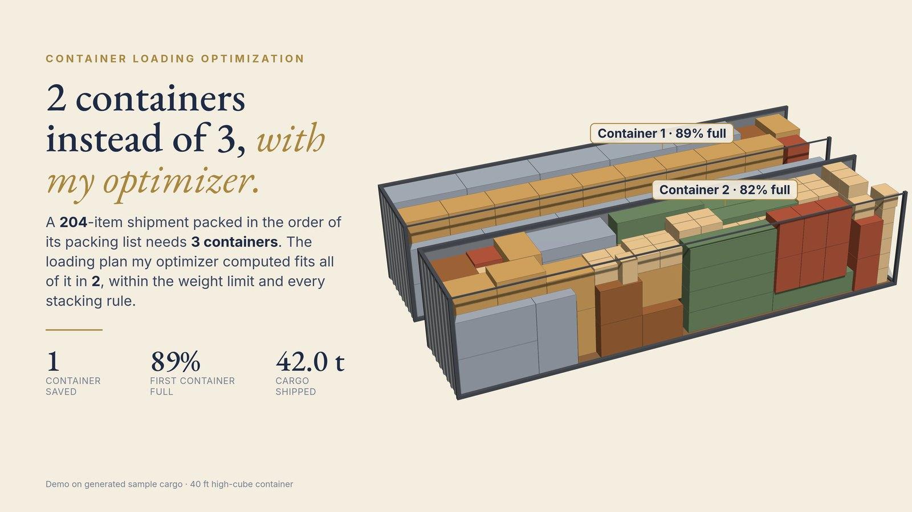
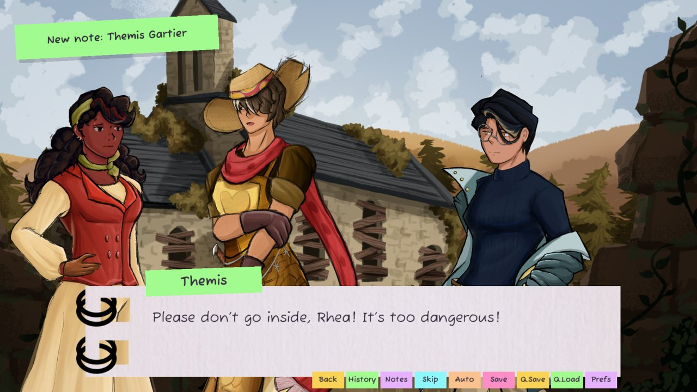

# Case studies

I'm Cristian Desivo, a mathematician and AI engineer. I take projects from a problem to a working
system on my own: modeling it, building the data and models, writing the code and shipping it.
These are some of them.

<table>
<tr>
<td width="50%" valign="top">

<h3><a href="container-loading/">Container loading optimization</a></h3>
An optimizer that fits a shipment into fewer containers. In the demo, 204 items fit in 2 containers instead of 3.
</td>
<td width="50%" valign="top">

<h3><a href="factory-scheduling/">Factory scheduling optimization</a></h3>
A scheduler that assigns orders to bays and tasks to workers, hour by hour. In the demo, late orders drop from 10 to 3.
</td>
</tr>
<tr>
<td width="50%" valign="top">

<h3><a href="directretrieval/">DirectRetrieval</a></h3>
An AI assistant that can only answer with answers you approved, word for word, or say nothing. Live demo on my site.
</td>
<td width="50%" valign="top">

<h3><a href="pixel-pi/">Pixel P.I.</a></h3>
My detective game on Steam: you type your own questions to suspects. Designed, built, shipped and sold on my own.
</td>
</tr>
<tr>
<td width="50%" valign="top">

<h3><a href="meteorites-map/">Meteorite landings map</a></h3>
NASA's 45,716 meteorite records, cleaned and put on an interactive map you can filter. Live on GitHub Pages.
</td>
<td width="50%" valign="top">

<h3><a href="aethertree/">Murder in the Aethertree Forest</a></h3>
A murder-mystery visual novel I led, wrote and programmed with a team in one month, for a game jam.
</td>
</tr>
<tr>
<td colspan="2" valign="top">
<h3><a href="ask-a-human/">Ask a human expert</a></h3>
A service I built and run on my site for people and AI agents stuck on a problem: send a 300-word summary, get my first reply within 15 minutes while I'm online. Machine-readable terms for agents included.
</td>
</tr>
</table>

## Work with me

- Site: [cristiandesivo.com](https://cristiandesivo.com/) (also [en español](https://cristiandesivo.com/es/))
- Contact: [cristiandesivo.com/hire_me/](https://cristiandesivo.com/hire_me/) · [Freelancer.com](https://www.freelancer.com/affiliates/email/18225913/) · [LinkedIn](https://www.linkedin.com/in/cristiandesivo/)
