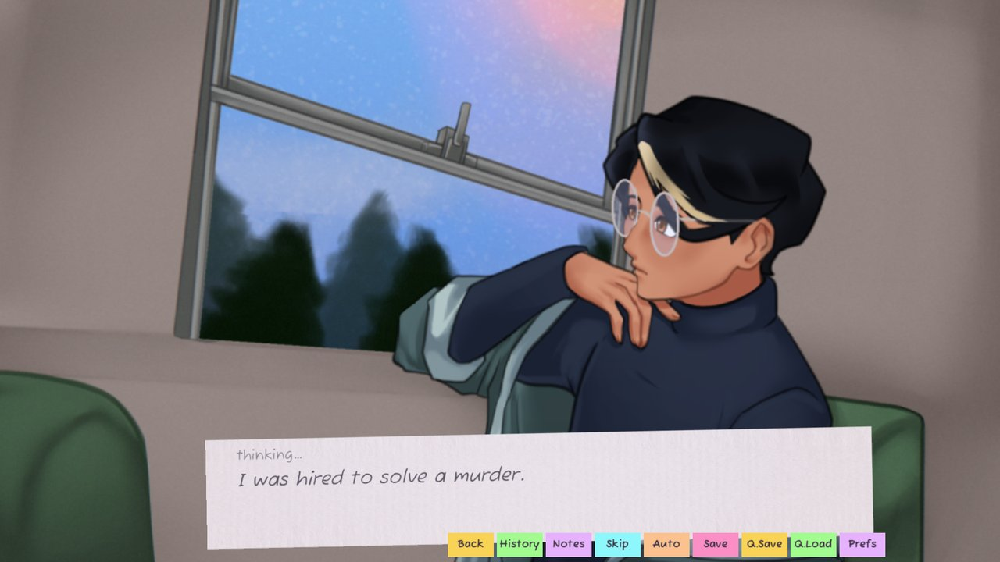
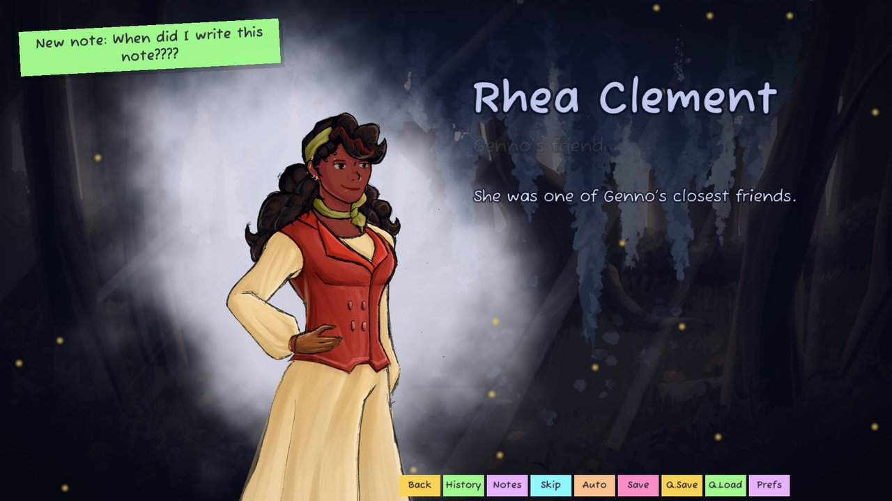
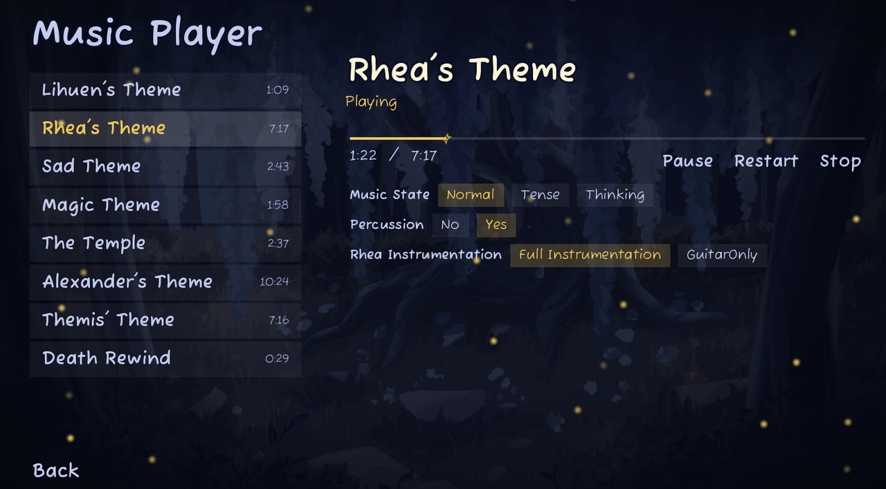

# Murder in the Aethertree Forest

**A supernatural murder-mystery visual novel I led, wrote and programmed in one month for the Spooktober Visual Novel Jam 2026. Free on itch.io.**

## The problem

A game jam gives you one month, a theme and a hard deadline. To ship a story-driven game in that time, you need a script that's finished and edited, art and music from a team of volunteers working in parallel, and game systems that hold all of it together. If any one of those slips, nothing ships.

## What I built

You play Lihuen, a struggling paranormal investigator hired to solve a murder in a small town during its fall festival. As the game's own tagline says, *you will die solving this murder*. Dying is part of the mystery, not the end of the game.

I was the project lead, writer and programmer. I wrote the story and the script, built the game in Ren'Py, and coordinated a team of 13 collaborators (art, music, sound, voice, editing, QA). On the player's side, that means:

- **Conversations you steer**: topic menus where you choose what to ask each character, and in what order.
- **A field notebook** that fills in as you play, with entries on characters, clues and ideas.
- **Portrait cards** that pop up whenever someone is mentioned, so you can keep track of a cast you've never met.
- **A rewind**: when Lihuen dies, the game plays their life back in reverse, scene by scene and line by line, through a VHS-style effect.
- **Adaptive music**: each theme shifts between normal, tense and thinking moods with the scene, and there's an in-game music player for the soundtrack.

## How it works

Opening on the train → **first life**: investigate the town, interview people, fill the notebook → **rewind** → **second life** → finale.

The game runs on Ren'Py, with its systems written in Ren'Py script and Python: the notebook's entries live in a data file that's checked for errors on startup, and the rewind records every line and scene as you play so it can replay them backwards. Sound and music run through FMOD Studio, which I connected to Ren'Py so the story can change the music's mood and trigger footsteps for each surface. Matt Chandler did the sound engineering in FMOD.

## Results

| One month, by the numbers | |
|---|---|
| Jam | Spooktober 8th Annual Visual Novel Jam, 1 Sep – 1 Oct 2026, 423 entries |
| Shipped | 1 Oct 2026, 03:08 UTC, before the 04:00 UTC deadline. Windows, macOS and Linux |
| Team | 14 people credited: me plus 13 collaborators |
| Script | 554 lines of dialogue and narration, 7,808 words |
| Cast | 7 speaking characters, 27 sprite images |
| Notebook | 22 entries in 3 categories |
| Music | 8 tracks in the in-game music player |
| Length | about half an hour per playthrough (itch.io estimate) |

The script counts come from Ren'Py's dialogue extraction, and the cast, sprite and notebook counts come from the project files. Jam results aren't out yet: judging ends 28 October 2026.

## Built with

Ren'Py 8.5 · Python · FMOD Studio · Git/GitHub. No generative AI was used for the game's content (itch.io disclosure).

**Credits:** Cris (project lead, writing, programming) · Cam and scarf (character design, sprites) · Sol (portraits) · Mai (CGs) · Ash (backgrounds, tarot cards, logo) · Nimsters (background colour and rendering) · Aashna (GUI elements) · FlexingWaffle22 (music) · Matt (sound engineering) · TylerVoiceActs (tarot voice-over) · Robert and Courtney (editing) · Blondi (QA)

## Links

- **Play it free on itch.io:** https://crischu.itch.io/murder-in-the-aethertree-forest
- **Jam entry:** https://itch.io/jam/spooktober-2026/rate/5078913
- **My site:** https://cristiandesivo.com/ (games section)

---

Want something like this? [cristiandesivo.com/hire_me/](https://cristiandesivo.com/hire_me/) · [Freelancer.com](https://www.freelancer.com/affiliates/email/18225913/)
