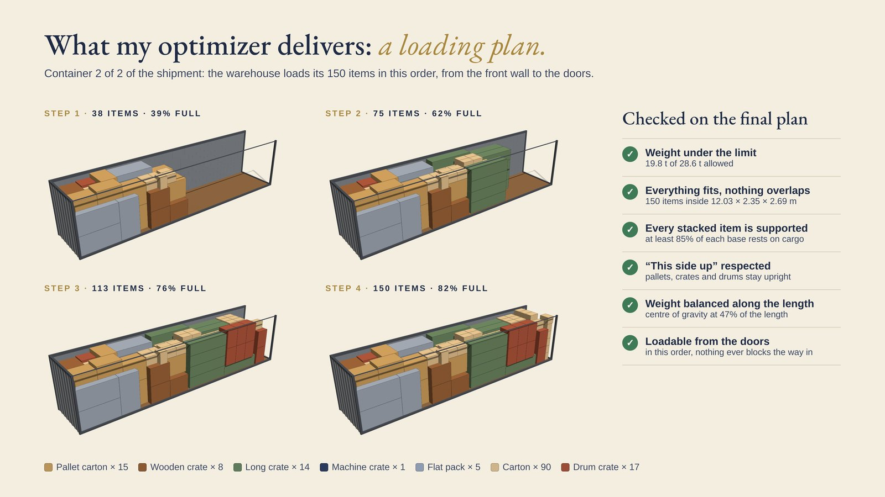
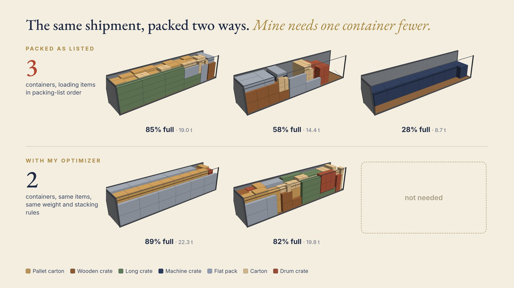

# Container loading optimization

I built an optimizer that plans how to load a shipment into as few containers as possible. In this
demo, 204 items fit in 2 containers instead of 3.

> **Demo with generated sample cargo.** I built a similar tool for a client; their data stays private.

## The problem

Shippers of mixed cargo (pallets, wooden crates, machine crates over a tonne, long crates, flat
packs, loose cartons) often load in packing-list order or by eye. That leaves gaps, and the last
container can ship mostly empty. A better plan is hard to find by hand: volume and weight both
limit the load, and every plan must follow real loading rules.

## What I built

From a spreadsheet of sizes, weights and quantities, the optimizer produces a step-by-step loading
plan for each container, from the front wall to the doors. Every plan:

- stays under each container's 28.6 t payload
- keeps "this side up" pallets, crates and drums upright
- rests at least 80% of every stacked item's base on cargo below
- comes with a loading order the warehouse can follow from the doors

Each rule is checked on the final layout, along with the weight balance along the length.

## How it works

1. The optimizer searches over the order and orientation of the items.
2. A placement routine packs each candidate, container by container, under the rules above.
3. It keeps the plans that use fewer containers and fill them better.
4. The best plan becomes a loading sequence, and the rules are checked on the final layout.

## Results

Demo with generated sample data: 204 items, 129.6 m³, 42.0 t, in 40 ft high-cube containers.

| | Containers | How full (by volume) |
|---|---|---|
| Packed in packing-list order | 3 | 85% · 58% · 28% |
| With my optimizer | 2 | 89% · 82% |

Both use the same items, the same 28.6 t weight limit and the same stacking rules. The baseline is
the same placement routine fed the items in packing-list order, so the difference is the value of
the search. The optimized plan came from an 8-minute search.

## Built with

Python and NumPy for the optimizer; three.js for the 3D renders of the plans.

## Links

- Full case on my site: [cristiandesivo.com/case/optimization/](https://cristiandesivo.com/case/optimization/)
- Fit your shipment in fewer containers: [cristiandesivo.com/problems/container-loading/](https://cristiandesivo.com/problems/container-loading/)

Want something like this? [cristiandesivo.com/hire_me/](https://cristiandesivo.com/hire_me/) · [Freelancer.com](https://www.freelancer.com/affiliates/email/18225913/)
