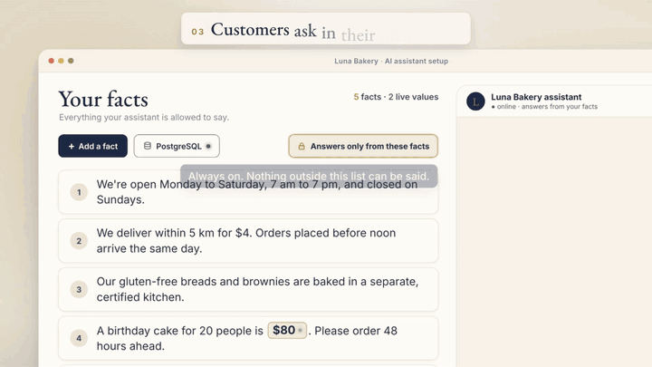
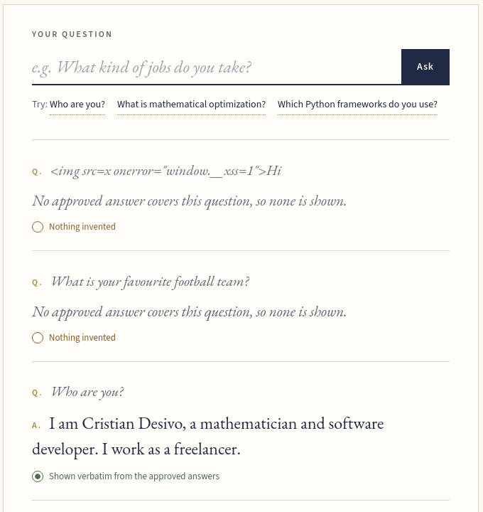
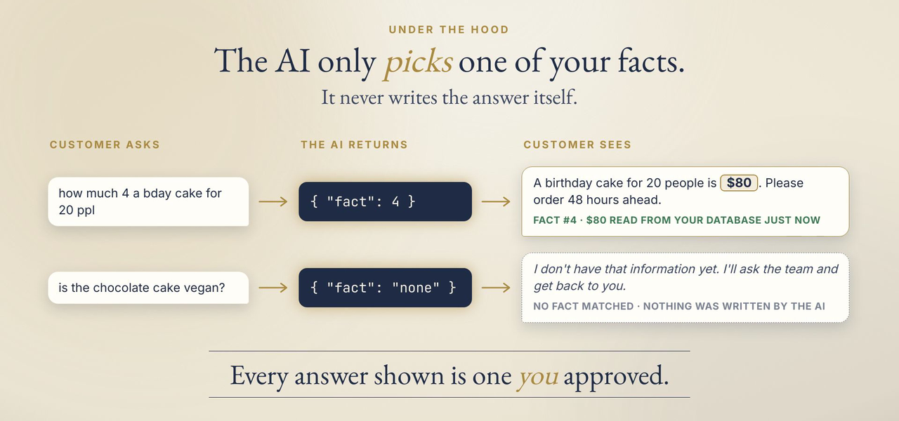

# DirectRetrieval

An AI assistant that can only answer with answers you approved, word for word, or say nothing.

Cut from the concept video ([full video, MP4](assets/directretrieval-video.mp4)). The fact editor and the live database values are a concept; picking the right approved answer, or none, is what the library does today.

## The problem

Businesses put chatbots on their sites, and the chatbots sometimes state prices, policies or opening hours that aren't true. Telling the model "only answer from our documents" doesn't fix it reliably: the model still writes the reply, so it can still invent. That has real costs: Air Canada was held liable for a refund policy its chatbot made up ([source](https://manatt.com/insights/newsletters/advertising-law/ai-gone-wild-airline-has-to-honor-a-refund-policy)).

## What I built

A Python library for assistants that are not allowed to make things up. The owner writes their facts as plain sentences. Customers ask in their own words, typos and slang included, and get back the fact that answers them, word for word. If none does, they get an honest "I'll ask the team" instead of a guess.

It runs the live demo on my site, which answers questions about me:

Screenshot of the live demo, 2026-10-08.

## How it works

- The model never writes the reply. A JSON schema limits its output to one approved answer, plus a yes or no on whether it really answers the question.
- The server checks the choice against the approved list, then shows that answer exactly as written. If nothing fits, nothing is shown.
- Prompt injection has little to work with: the worst case is picking the wrong approved answer, never saying something new.

## Results

No client deployment or accuracy benchmark yet, so no performance numbers. What you can check yourself: the live demo answers from 8 approved answers, and every reply it shows is one of them, or nothing.

## Built with

Python · structured outputs (JSON schema) · OpenAI API · Ollama · llama.cpp · OpenRouter free models (live demo) · Django (site)

## Links

- Live demo: [cristiandesivo.com/ask_question/](https://cristiandesivo.com/ask_question/)
- Site case: [cristiandesivo.com/case/llm/](https://cristiandesivo.com/case/llm/)
- The problem, in plain words: [Stop your chatbot from making things up](https://cristiandesivo.com/problems/chatbot-making-things-up/)
- Code: private for now.

Want something like this? [cristiandesivo.com/hire_me/](https://cristiandesivo.com/hire_me/) · [Freelancer.com](https://www.freelancer.com/affiliates/email/18225913/)
