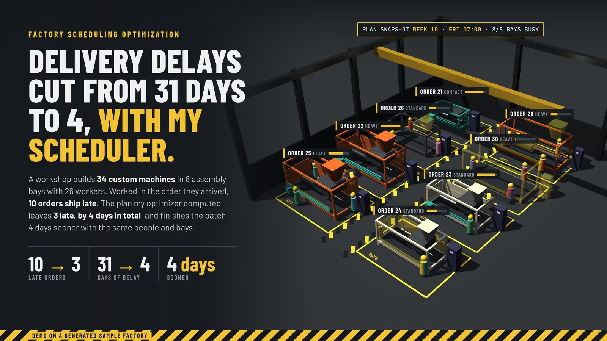
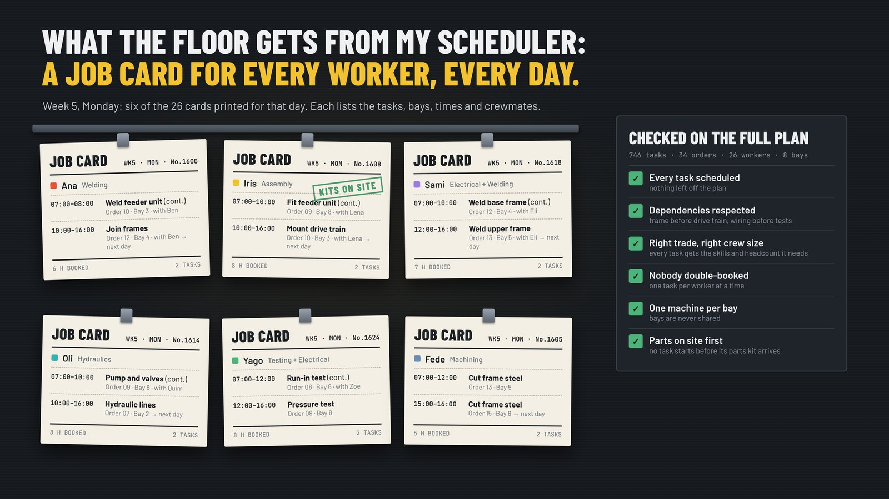
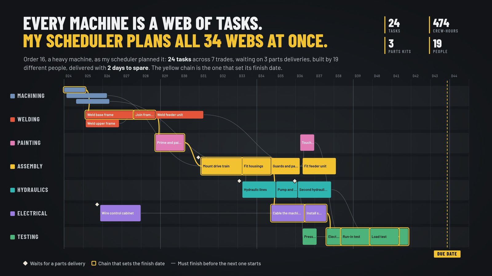
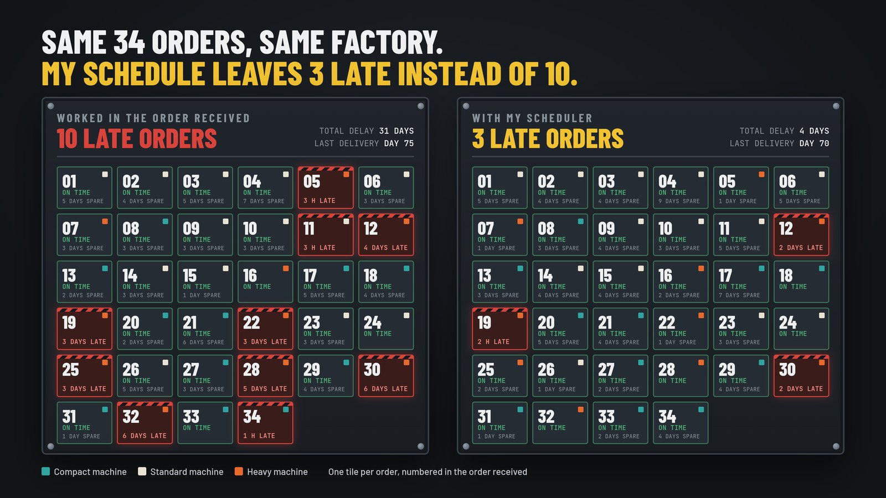

# Factory scheduling optimization

I built a scheduler that decides which order goes into which assembly bay and which worker does
which task, hour by hour. In this demo, late orders drop from 10 to 3.

> **Demo with a generated sample factory.** I've built schedulers like this for clients; their data stays private.

## The problem

A workshop builds 34 custom machines, 746 tasks in all, in 8 assembly bays with 26 workers who
each have one or two trades. Every machine is a network of tasks that wait on each other and on
parts deliveries. Worked in the order they arrived, a few long jobs block the bays and the people
everyone else is waiting for, and 10 orders ship late even though the capacity was there.

## What I built

The scheduler works from the orders and due dates, the tasks each one needs and in what order, the
bays, the people and their trades, and the parts delivery dates. Every plan respects:

- task dependencies, such as frame before drive train and wiring before tests
- skills and crew size: each task gets the trade and headcount it needs
- workers with one or two trades, never double-booked
- one machine per bay at a time
- parts kits: no task starts before its kit is delivered

The output is a delivery plan per order and a daily job card for every worker, listing their
tasks, bays, times and crewmates. The rules are checked on the full plan.

## How it works

1. The scheduler searches over priorities: which order goes into a free bay next, and which
   ready task starts first.
2. Each candidate is turned into an hour-by-hour plan that follows every rule above.
3. It keeps the plans with fewer late orders, then less total delay, then an earlier finish.
4. All 34 task networks are planned at once. Below is one heavy order as scheduled: 24 tasks,
   3 parts deliveries, 19 different people, delivered with 2 days to spare.

## Results

Demo with generated sample data: 34 orders, 746 tasks, 26 workers, 8 bays.

| | Late orders | Total delay | Whole batch done |
|---|---|---|---|
| Worked in the order received | 10 | 31 working days | after 593 working hours (day 75) |
| With my scheduler | 3 | 4 working days | after 559 working hours (day 70): 4 working days sooner |

Same orders, same people, same bays. The plan came from a 6-minute search.

## Built with

Python and NumPy for the scheduler; three.js for the 3D render of the factory floor.

## Links

- Full case on my site: [cristiandesivo.com/case/optimization/](https://cristiandesivo.com/case/optimization/)
- Production schedule always late? [cristiandesivo.com/problems/production-scheduling/](https://cristiandesivo.com/problems/production-scheduling/)
- Optimization model infeasible or too slow? [cristiandesivo.com/problems/optimization-model/](https://cristiandesivo.com/problems/optimization-model/)

Want something like this? [cristiandesivo.com/hire_me/](https://cristiandesivo.com/hire_me/) · [Freelancer.com](https://www.freelancer.com/affiliates/email/18225913/)
