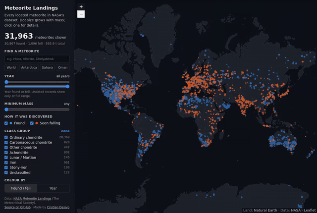
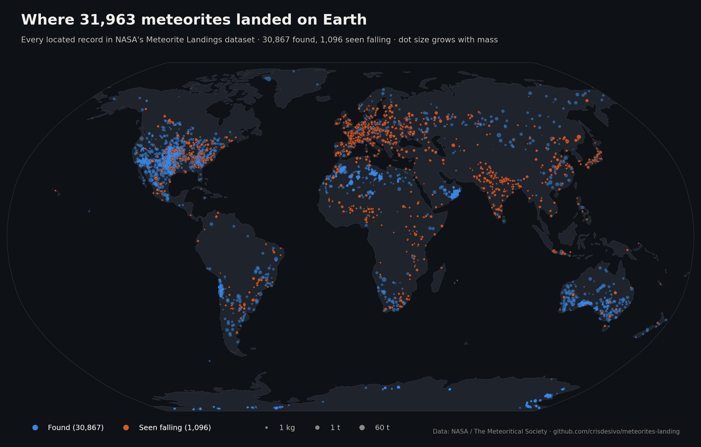
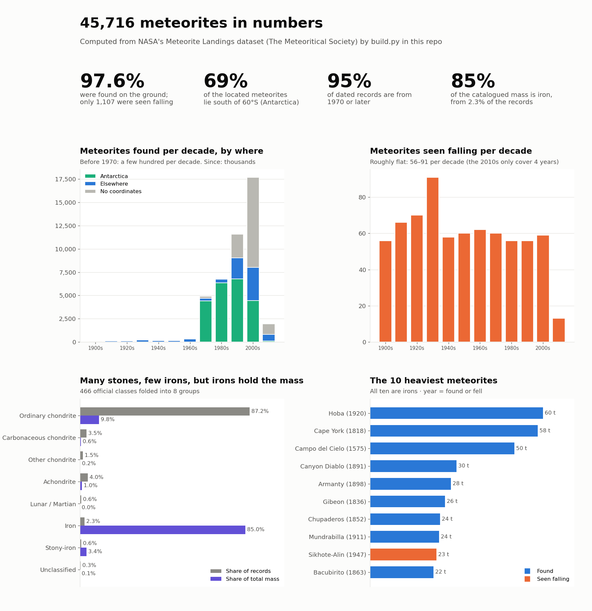

# Meteorite landings map

**NASA's 45,716 meteorite records, cleaned and put on one interactive map you can filter by year, mass, class and found/fell.**

## The problem

NASA publishes the Meteoritical Society's catalogue of every known meteorite as one CSV. It's a great dataset, and a messy one: thousands of rows have no coordinates or placeholder ones, one record isn't on Earth at all, and hundreds of Antarctic finds have a broken latitude. Plot it as-is and you get a misleading map. On top of that, a plain table can't show you where meteorites turn up, or why.

## What I built

- **An interactive map**: all 31,963 usable records on one static page (no server, no API keys). You can filter by year range, minimum mass, found vs. seen falling and 8 class groups, colour the dots by found/fell or by year, search by name, and jump to Antarctica, the Sahara or Oman. Clicking a dot shows its class, mass, year and a link to its Meteoritical Bulletin entry.
- **A static world map and an infographic** with the main findings.
- **A cleaning pipeline** that rebuilds everything from NASA's raw CSV with one command.

## How it works

**NASA CSV** → **clean and classify** (one Python module, the single source of truth) → **build script** → static map, infographic, `insights.json` and the data files for the interactive map → **GitHub Pages**.

The interactive map draws every point on a single canvas layer, so panning and filtering stay smooth with 31,963 dots. Land and borders ship with the page, so there's no tile server to break. The 466 official meteorite classes (`L6`, `CM2`, `Iron, IIIAB`, …) are folded into 8 broad groups for filtering.

## Results

Every number here is computed from NASA's CSV (downloaded October 2026) by the build script and saved to `insights.json`.

**Cleaning: what I found wrong in the data**

| Records | |
|---:|---|
| 45,716 | in the dataset |
| −7,315 | no coordinates |
| −6,214 | coordinates are the (0, 0) placeholder |
| −1 | *Meridiani Planum*: found **on Mars** by the Opportunity rover |
| −223 | Yamato finds (Antarctica) recorded with latitude 0, which would put them in Kenya |
| **31,963** | **mapped** |

Years outside 800–2016 (one record says 2101) are kept but treated as unknown. Thousands of finds also share one dot: 4,761 records sit at exactly 71.5°S, 35.67°E (the Yamato ice field), and the 31,963 mapped meteorites share only 17,097 distinct locations, so the map tells you how many records are stacked under each dot.

**What the data says**

- **97.6% were found, not seen falling** (44,609 finds, 1,107 witnessed falls). Witnessed falls cluster where people live; finds cluster on ice and desert, where a dark stone stands out.
- **69% of the mapped meteorites are in Antarctica** (22,099 south of 60°S).
- **95% of dated records are from 1970 or later.** Witnessed falls stay flat at 56–91 per decade through the 20th century.
- **Stones are common, irons are heavy.** Ordinary chondrites are 87.2% of the records but 9.8% of the mass; irons are 2.3% of the records and 85.0% of the mass.
- **The 10 heaviest are all irons**, led by Hoba (60 t). Sikhote-Alin (23 t, 1947) is the only one of the ten that was seen falling.

## Built with

Python 3.12 · pandas · NumPy · matplotlib · Cartopy · Shapely · Jupyter · Leaflet · Natural Earth basemap · GitHub Pages · Playwright + ffmpeg (demo recording)

## Links

- **Live map:** https://crisdesivo.github.io/meteorites-landing/
- **Repo** (code, data, full write-up): https://github.com/crisdesivo/meteorites-landing
- **Data:** [Meteorite Landings](https://data.nasa.gov/dataset/meteorite-landings), NASA / The Meteoritical Society

---

Want something like this? [cristiandesivo.com/hire_me/](https://cristiandesivo.com/hire_me/) · [Freelancer.com](https://www.freelancer.com/affiliates/email/18225913/)
