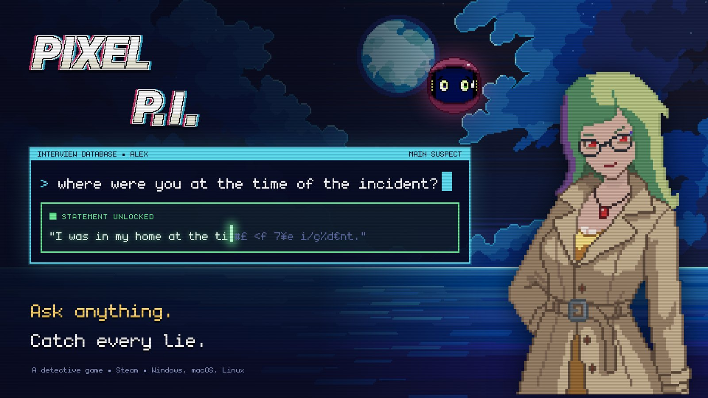
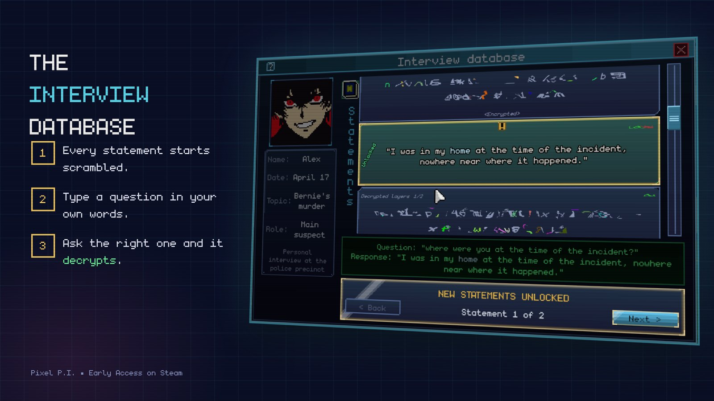
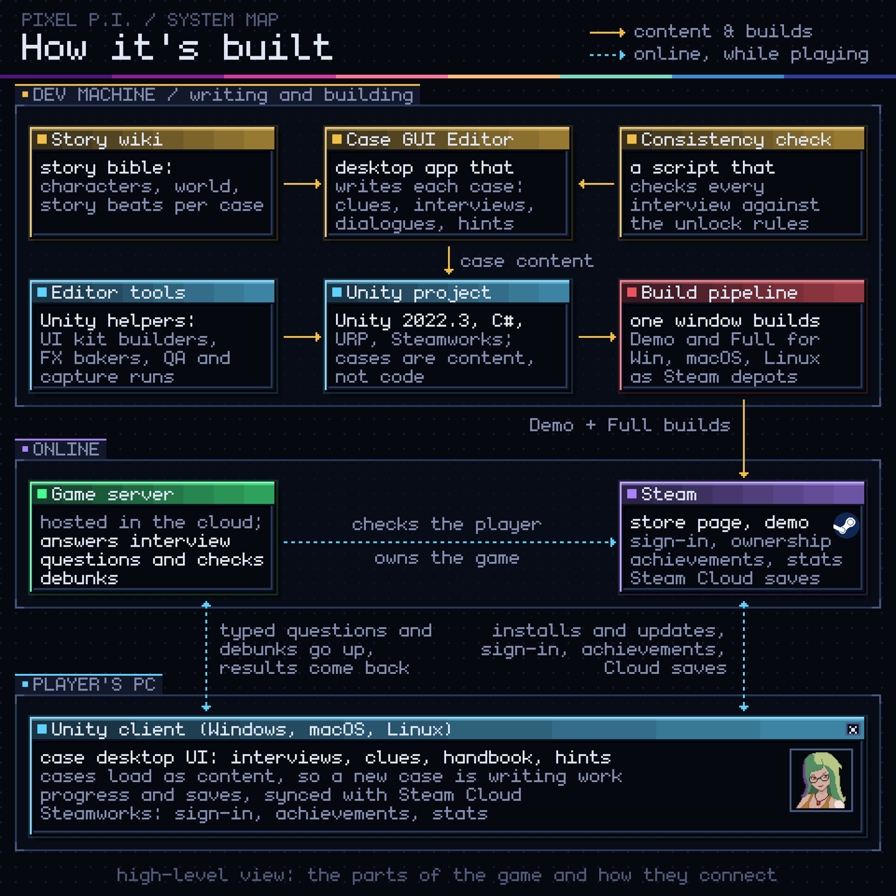
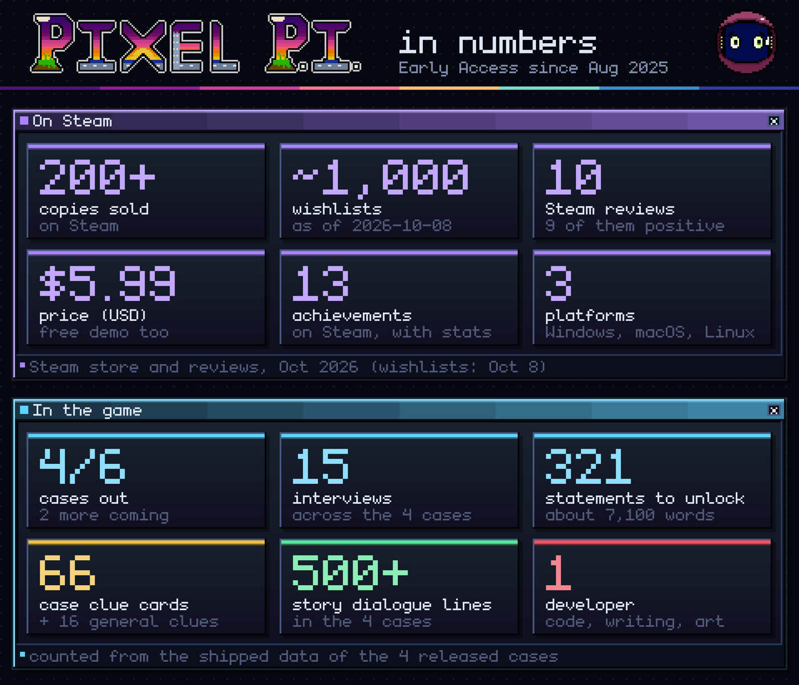

# Pixel P.I.

**A detective game I make on my own and sell on Steam: you type your own questions to suspects, in your own words, and a statement unlocks when you ask what the police asked.**

## The problem

Detective games usually hand you the questions: you pick from a menu, so the game does the thinking
and the "aha" is never yours. Letting players ask anything is the obvious fix, and the hard part. The
game has to recognise questions phrased in ways it was never shown, and still never give away the
solution.

## What I built

You play Pixel, a hacker detective who lost two years of memories and hacks the police database to
reopen old cases. Each interview is a list of encrypted statements:

- **Ask anything.** Type a question; if the police asked something like it, that statement decrypts.
- **Debunk.** Pick a clue that contradicts a statement and explain in your own words why it's false.
  If you're right, the witness has to correct it, and the case opens up.
- **Accuse.** When you think you know who did it, you accuse, and it can't be undone.

## How it works

The game is a Unity client for Windows, macOS and Linux. A small server answers the interview
questions while you play, and Steam handles the store, sign-in, achievements and cloud saves. Cases
are content, not code: I write them in my own case editor, check them with my own tools, and a build
pipeline ships the demo and the full game to Steam.

## Results

In Early Access on Steam since August 2025, with a free demo.

## Built with

Unity (C#, URP, Steamworks) · a hosted game server · my own case editor and build tools. Code,
writing, pixel art and music arrangements by me; the music arranges public-domain classical pieces,
some backgrounds are CraftPix assets, and the sound effects are third-party.

## Links

- Steam: [store.steampowered.com/app/2448910/Pixel_PI/](https://store.steampowered.com/app/2448910/Pixel_PI/)
- Game website: [pixelpigame.com](https://pixelpigame.com/) · itch.io: [crischu.itch.io/pixel-pi](https://crischu.itch.io/pixel-pi)
- Games case on my site: [cristiandesivo.com/case/games/](https://cristiandesivo.com/case/games/)

Want something like this? [cristiandesivo.com/hire_me/](https://cristiandesivo.com/hire_me/) · [Freelancer.com](https://www.freelancer.com/affiliates/email/18225913/)
